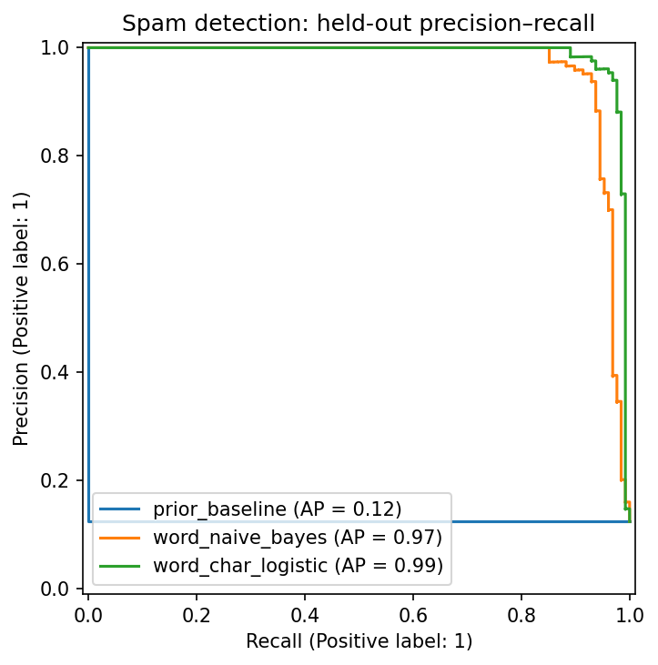
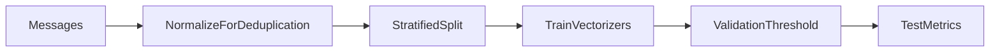

<p align="center"></p>

# SMS Spam Detector

**A spam filter with an explicit precision tradeoff.**

[](https://github.com/Djordje3002/sms-spam-detector/actions/workflows/ci.yml)


Classify short English SMS messages as ham or spam. Blocking a legitimate message has a different cost from missing spam, so this project chooses the decision threshold against an explicit validation precision target and reports the tradeoff on held-out messages.

**Project 2/6 · Intermediate** in the [Machine Learning Portfolio](https://github.com/Djordje3002/ml-portfolio).

## What this project demonstrates

TF-IDF · character n-grams · logistic regression · threshold selection · precision–recall.

Working training and prediction commands, real benchmark data, baseline comparisons, committed measured reports, an experiment-review notebook, regression tests and CI. This is a reproducible portfolio experiment; results describe the stated benchmark protocol.

## Measured results

| Model | average precision | precision | recall | f1 |
| --- | ---: | ---: | ---: | ---: |
| `prior_baseline` | 0.1240 | 0.0000 | 0.0000 | 0.0000 |
| `word_naive_bayes` | 0.9669 | 0.9741 | 0.8828 | 0.9262 |
| `word_char_logistic` | 0.9877 | 0.9756 | 0.9375 | 0.9562 |


**Selected using training CV or validation:** `word_char_logistic`. The tables report test results; selection is never changed to favor the test winner.

The selected word-plus-character logistic model reaches 97.56% test precision and 93.75% test recall. Its 98% validation precision target is not a guarantee on new messages: three legitimate messages are false positives on the test set. The prior baseline predicts no spam under this policy and has F1 zero. Scores are model outputs, not independently calibrated risk estimates.



Full precision, split counts, package versions and source provenance are in [metrics.json](reports/metrics.json). The committed run used Python 3.11 on macOS with seed 42. Results can vary slightly across platforms and dependency versions. These numbers are benchmark measurements, not production performance promises.

## Run locally

Use Python 3.11 or 3.12 and run commands from the repository root. No API key, paid service or GPU is required. The first training run downloads the small source archive; subsequent runs verify and reuse the local cache. The digits project uses scikit-learn's bundled dataset instead.

```bash
git clone https://github.com/Djordje3002/sms-spam-detector.git
cd sms-spam-detector
python3.11 -m venv .venv
source .venv/bin/activate
python -m pip install -e ".[dev]"
python -m sms_spam train
python -m sms_spam predict --input examples/sample.json
python -m pytest -q
```

On Windows, activate with `.venv\Scripts\activate`. A Python 3.12 installation can replace `python3.11` in the setup command. Start with a few minutes of CPU time; training time depends on your machine, with the CNN and factorization requiring more work than the small tabular examples.

Training writes local models to `artifacts/` and refreshes `reports/`. Datasets and trained binaries are excluded from Git. The example JSON is an input contract, and predictions are calculated from the locally trained model.

## Experiment design



Casefolded, whitespace-normalized messages define duplicates. Conflicting duplicate-label groups are discarded; one representative of every remaining normalized message is retained. Seeded stratified splits allocate 60%/20%/20% to train/validation/test. Vectorizers learn vocabulary and IDF only on training text. Each candidate gets the validation threshold with maximum F1 subject to precision ≥ 0.98; the model with highest feasible validation F1 is selected. With no feasible threshold, the model predicts no spam.

### Data provenance

UCI SMS Spam Collection: this archive parses to 5,574 labeled lines. After normalized duplicate and conflict handling, 5,159 messages remain. The original corpus combines several historical SMS sources, so it is not a current or geographically representative messaging sample.

Source: [SMS Spam Detector dataset](https://archive.ics.uci.edu/dataset/228/sms+spam+collection). See [Data card](docs/DATA_CARD.md) for attribution, integrity and usage terms.

## Explore the evidence

- [Experiment review notebook](notebooks/01_review_results.ipynb): inspect the committed metrics, compare models and view the actual evaluation chart.
- [Model card](docs/MODEL_CARD.md): intended use, evaluation boundary and failure modes.
- [Experiment protocol](docs/EXPERIMENTS.md): reproduction steps and selection rules.
- [Prediction input](examples/sample.json): a complete example for the command-line interface.

The confusion matrix is stored as `[TN, FP, FN, TP]` in the JSON report. The example message is newly written for this repository; raw historical messages are not committed.

## Repository structure

```text
src/sms_spam/       Training, prediction and integrity helpers
tests/                   Offline regression and contract tests
data/source.json         Source URL and expected SHA-256 (downloaded datasets)
data/raw/                Local verified dataset cache; ignored by Git
examples/                Ready-to-run prediction inputs
notebooks/               Executed experiment review
reports/                 Measured metrics and evaluation plots
docs/                    Data card, model card and experiment protocol
artifacts/               Locally trained models; ignored by Git
.github/workflows/       Lint, tests and full benchmark training
```

## Quality checks

```bash
make check test
make train
```

Normalized duplicates and contradictory labels are handled before splitting; feasible thresholds satisfy the precision constraint; infeasible policies abstain from spam predictions; blank, oversized and non-string inputs fail validation; checksum mismatches are rejected.

CI repeats lint, formatting, tests and the complete training/evaluation command on Linux, then uploads reports for inspection. Training requires network access only on a cache miss. Offline tests use small constructed fixtures rather than substitute benchmark data.

## Limits and responsible interpretation

Near-duplicate templates can survive exact normalized deduplication. Sender IDs, campaign IDs and reliable chronology are unavailable, so this is not an unseen-campaign or temporal deployment estimate. Non-English text, modern phishing campaigns and adversarial obfuscation require fresh evaluation. Do not automatically delete user messages based on this demonstration.

## License and attribution

Code is [MIT licensed](LICENSE). Dataset rights are separate; see [Data card](docs/DATA_CARD.md). Built with Python and the libraries listed in [pyproject.toml](pyproject.toml).

**Dataset citation:** Almeida, T. & Hidalgo, J. (2011). SMS Spam Collection. UCI Machine Learning Repository. https://doi.org/10.24432/C5CC84

Created by [Djordje Kartaljevic](https://github.com/Djordje3002). [Explore the full progression →](https://github.com/Djordje3002/ml-portfolio)
